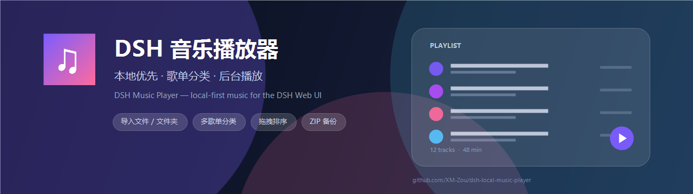
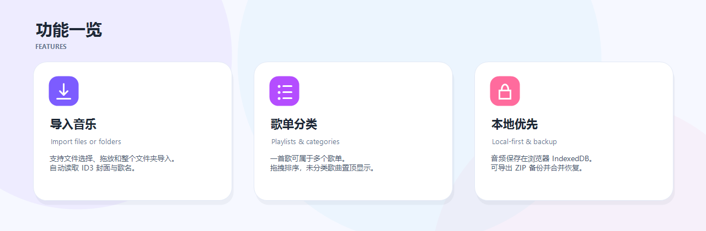

<p align="center">
  
</p>

<p align="center">
  面向 DSH Web UI 的本地优先音乐播放器与歌单管理插件。
</p>

<p align="center">
  <a href="LICENSE"></a>
  <a href="https://github.com/XM-Zou/dsh-local-music-player/stargazers"></a>
</p>

中文 | [English](README.en.md)

## 功能

<p align="center">
  
</p>

- **左侧栏入口**：点击全局左侧栏的「音乐」图标进入播放器页面。
- **导入本地音乐**：点击「导入音乐」选择文件，或直接把音频拖到页面。
- **导入文件夹**：选择一个文件夹，文件夹名会自动变成新歌单名，里面的音频会一起导入；音乐库已有的歌曲会直接复用，不会重复导入。
- **读取标签与歌名**：读取 ID3v2 标题和封面；不识别歌手和专辑。文件名中有《》时，优先用书名号里的文字作为歌名，书名号外的文字作为歌曲信息；没有《》时用 ID3 标题或文件名。
- **重新解析歌曲信息**：旧版本导入的歌曲可以点顶部的「重新解析歌曲信息」，按新规则更新歌名和歌曲信息，不需要重新导入。
- **歌单分类**：新建、重命名、删除歌单；一首歌可以加入多个歌单；侧栏歌单可以拖动排序。
- **列表显示所在歌单**：歌曲列表不再显示专辑，而是显示这首歌所属的歌单；没有歌单时显示「未分类」。歌曲副标题显示歌曲信息。
- **置顶的「未分类」歌单**：没有加入任何歌单的歌曲会自动出现在这个置顶、不可删除的歌单里。
- **安全的歌单删除**：删除歌单时默认保留歌曲；未在其他歌单中的歌曲进入「未分类」，仍在其他歌单中的歌曲保留在原歌单。也可以选择同时从音乐库删除歌曲；与其他歌单共享的歌曲会在删除前提示。
- **完整播放控制**：播放/暂停、上一首/下一首、进度、音量、随机播放、顺序/列表循环/单曲循环。
- **后台播放**：切换 DSH 面板时通常会继续播放；暂停、退出 DSH 或宿主挂起时停止。
- **搜索与最近添加**：按歌名、歌曲信息或文件名过滤；最近导入的歌曲优先显示。
- **本地优先存储**：音频 Blob 和歌单保存在浏览器 IndexedDB，不上传。
- **备份与恢复**：顶部备份按钮可以把所有音乐、封面和歌单导出为 ZIP，也可以从 ZIP 合并恢复；已存在的歌曲会复用，同名歌单会合并。
- **贴合宿主外观**：使用 DSH 主题 token，支持亮/暗主题，并适配窄窗口。
- **中英双语界面**。

## 安装

> 已发布到 npm：`dsh-local-music-player@0.7.3`。  
> DSH Desktop 自带 CLI 在 `D:\ruanjian\DSH\resources\runtime\cli\bin\dsh.cmd`，默认不在 PATH；下面用 `& "..."` 直接调用。路径以你的 DSH 安装目录为准。  
> 如果 `npmmirror` 返回 `500`（当前部分网络会出现），桌面端界面安装可能报错；推荐用下面的 CLI，并显式指定 npmjs registry。  
> 市场条目可能比 npm 稍晚同步；如果市场里看到的不是 `0.7.3`，用 npm 命令安装。

| 环境 | 推荐方式 |
| --- | --- |
| DSH Desktop | **设置 → 插件**；如果报 `E500`，用下面的 CLI |
| DSH Web | `dsh.cmd plugin --profile web add dsh-local-music-player --registry=https://registry.npmjs.org` |
| DSH Desktop CLI | `dsh.cmd plugin --profile desktop add dsh-local-music-player --registry=https://registry.npmjs.org` |
| 自定义 profile | 把 `web` / `desktop` 换成你的 profile 名 |
| 插件市场 | **插件 → 发现（Discover）** 搜索；版本落后时用 npm |

> 表中的 `dsh.cmd` 指 DSH Desktop 自带 CLI，完整路径见下方。  
> 市场页：<https://awesome-dsh-plugin.com/p/XM-Zou/dsh-local-music-player/>

### DSH Desktop 界面

打开 **设置 → 插件**，在安装/添加来源里粘贴：

```text
dsh-local-music-player
```

如果界面报 `E500` / 找不到版本，用下面的 CLI（显式指定 npmjs registry）。

### DSH Web（CLI）

```powershell
& "D:\ruanjian\DSH\resources\runtime\cli\bin\dsh.cmd" plugin --profile web add dsh-local-music-player --registry=https://registry.npmjs.org
```

如果 `dsh` 已在 PATH，可以简写：

```sh
dsh plugin --profile web add dsh-local-music-player --registry=https://registry.npmjs.org
```

### DSH Desktop（CLI）

```powershell
& "D:\ruanjian\DSH\resources\runtime\cli\bin\dsh.cmd" plugin --profile desktop add dsh-local-music-player --registry=https://registry.npmjs.org
```

如果之前用本地目录链接安装过，先移除再装：

```powershell
& "D:\ruanjian\DSH\resources\runtime\cli\bin\dsh.cmd" plugin --profile desktop remove dsh-local-music-player
& "D:\ruanjian\DSH\resources\runtime\cli\bin\dsh.cmd" plugin --profile desktop add dsh-local-music-player --registry=https://registry.npmjs.org
```

### GitHub 源码备用

如果 npm 镜像还没同步或网络异常，可以改用 GitHub 源码安装：

```powershell
& "D:\ruanjian\DSH\resources\runtime\cli\bin\dsh.cmd" plugin --profile web add github:XM-Zou/dsh-local-music-player --registry=https://registry.npmjs.org
& "D:\ruanjian\DSH\resources\runtime\cli\bin\dsh.cmd" plugin --profile desktop add github:XM-Zou/dsh-local-music-player --registry=https://registry.npmjs.org
```

### 直接下载

不安装 CLI 也可以直接下载 tarball：

[下载 dsh-local-music-player-0.7.3.tgz](https://github.com/XM-Zou/dsh-local-music-player/releases/download/v0.7.3/dsh-local-music-player-0.7.3.tgz)

> npm 是首选；GitHub Release 直链在部分网络下可能 `ETIMEDOUT`，这时用上面的 `github:` 源码安装。

## 使用

1. 点击左侧栏的「音乐」图标。
2. 点击「导入音乐」，或把音频文件拖到页面。
3. 也可以点「导入文件夹」，一步把整个文件夹变成新歌单。
4. 新建歌单，然后点歌曲行上的 **+**，把歌曲加入一个或多个歌单。
5. 点击歌曲播放；底部播放器支持进度、音量、随机和循环。

没有加入任何歌单的歌曲会自动出现在置顶的「未分类」歌单里。删除歌单时，默认保留歌曲；未在其他歌单中的歌曲进入「未分类」，仍在其他歌单中的歌曲保留。也可以选择同时从音乐库和所有歌单中删除。

需要备份时，点顶部右侧的备份图标，选择「导出音乐库」；恢复时选择「导入音乐库」，会合并到现有音乐库。

## 数据与隐私

- 导入的音频和歌单数据保存在 DSH 浏览器源下的 **IndexedDB**。
- 插件不发起网络请求，也没有遥测。
- 清除站点数据、DSH 端口/origin 变化、或换浏览器配置，都可能让插件里看不到原来的音乐库。
- 能否播放某种格式取决于宿主的 Chromium/Electron 解码能力；常见支持 MP3、FLAC、WAV、M4A/AAC、OGG、Opus。

### 备份格式

ZIP 内包含 `audio/`、`covers/` 和 `playlists.json`。音频按歌单分文件夹：

```text
audio/
  华语/
    《下个路口见》-李宇春-【Hi-Res无损】.mp3
  日语/
    ...
  未分类/
    ...
```

- 一首歌属于多个歌单时，会复制到每个歌单文件夹里，保证每个文件夹完整；ZIP 体积会相应变大。
- 没有歌单的歌曲放在 `未分类/`（英文界面为 `Uncategorized/`）。
- 空歌单也会生成空文件夹。
- `playlists.json` 是 UTF-8 JSON（带 BOM），每条歌曲只保留必要字段：
  - `id`：歌单引用用的内部 ID
  - `title` / `info`：歌名 / 歌曲信息
  - `duration`：时长（秒）
  - `fileName`：导入时的原始文件名
  - `audio`：ZIP 内的音频路径（共享歌曲指向第一个歌单文件夹）
  - `cover`：可选的封面路径

歌单只保留 `name` 和 `trackIds`。导入兼容旧版 v1 备份。

## 兼容性

- DSH `>= 0.2.1`（通过 `engines.dsh` 声明）。
- 已在 DSH `0.2.2-rc.1` 的 Desktop / Web UI 上测试。
- 无构建步骤、无运行时依赖；Client 半是纯 JavaScript。

## 开发

```sh
npm run check        # 校验清单、locale、图标、id/patch 一致性和翻译 key
npm pack --dry-run   # 查看 npm 包内容
```

本地开发时，用 CLI 把当前目录作为依赖加入 profile：

```powershell
& "D:\ruanjian\DSH\resources\runtime\cli\bin\dsh.cmd" plugin --profile desktop add "D:\chengxu\DSH\音乐播放器\dsh-music-player"
```

如果 `dsh` 已在 PATH，也可以简写：

```sh
dsh plugin --profile desktop add "<本目录绝对路径>"
```

修改包名时，三处必须一起改：

- `package.json` → `name`
- `client.js` → `window.__ModuleLoader__.load({ id })`
- `cordis.patch.yml` → `name`

请保持 `DB_NAME` 和 `LS_*` 存储键不变，这样升级后已有的音乐库和设置不会丢。

## 已知限制

- 暂不支持云同步。
- ZIP 备份不支持 ZIP64，单个备份超过 4 GB 时无法导出。
- 受浏览器存储配额限制，特别大的音乐库可能导入失败。
- 音乐库只存在于当前浏览器 origin，不跨设备共享。

## 贡献

欢迎提 issue 和 PR。提交 PR 前请先运行 `npm run check`；除非提供迁移，否则不要改存储键。

## 许可证

[MIT](LICENSE) © 2026 XM-Zou
