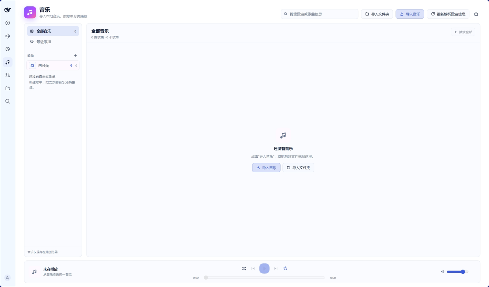
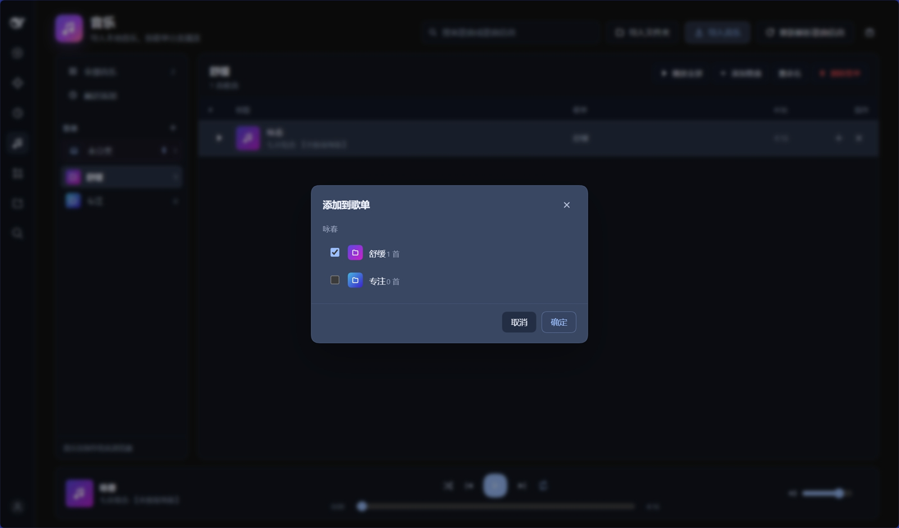
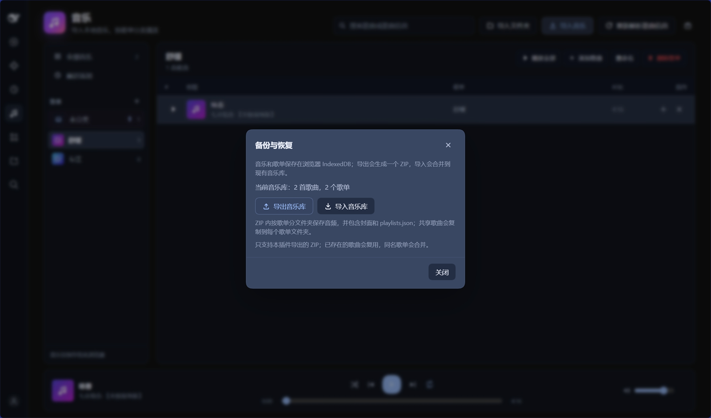

# Screenshots

The README already uses the generated banner and feature artwork. Real UI screenshots make the plugin page much more convincing.

## Web UI

The `web` profile has `dsh-local-music-player@0.7.3` installed. Open the **Music** icon in the current DSH Web UI. If it is missing, restart the web app or refresh the page.

For the screenshots, use a small demo library (3–4 tracks, 2 playlists) with non-private names. Do not capture personal file paths or copyrighted album art.

## What to capture

Save these as PNG files in this directory:

| File | What to show |
| --- | --- |
| `sidebar-entry.png` | The global left sidebar with the Music icon visible |
| `player.png` | The player page with a few playlists, a track list, and the player bar |
| `playlist-menu.png` | The "add to playlist" picker or the playlist deletion dialog |
| `backup.png` | The Backup & restore dialog |
| `folder-import.png` | The import-folder button or the import progress state |

## How to capture

1. Open the Music plugin in DSH.
2. Use **Win + Shift + S** and select the plugin area.
3. Crop out the Windows taskbar, personal paths, and private song names if needed.
4. Save the PNG into `docs/screenshots/`.
5. Keep the image width around 1200–1600 px; the README scales it to 100%.

## README insertion

Add a Screenshots section after the feature list, for example:

```html
## Screenshots

<p align="center">
  
</p>

<p align="center">
  
  
</p>
```

Do not use screenshots that contain private file names, personal playlists, or copyrighted album art you cannot redistribute.
